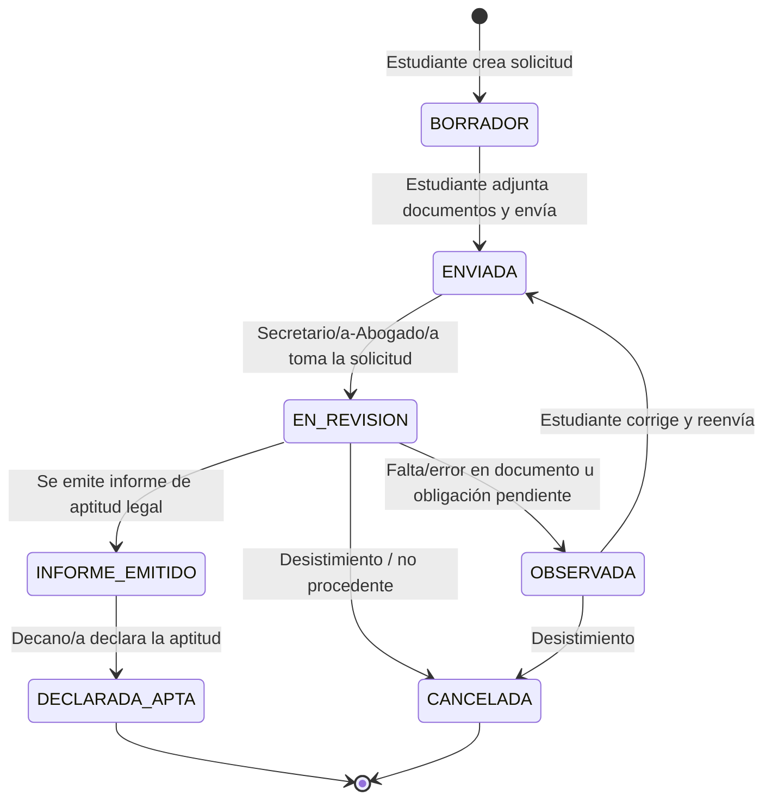

# 03. Alcance del MVP, flujo inicial y etapas SDD

**Proyecto:** SGT-SIAAF — Sistema de Gestión del Trámite de Titulación integrado al SIAAF
**Asignatura:** Desarrollo Basado en Plataformas (5.º ciclo, Computación, UNL) — ACD1
**Responsable de este archivo:** Integrante 3 (alcance) · **Elaboración conjunta del borrador:** Integrante 5
**Estado:** Propuesta inicial, **pendiente de acuerdo del equipo y de validación del docente**

> Todo lo que aquí se marca como *propuesta* o *por confirmar* no debe tratarse todavía como requisito. Las fuentes normativas citadas provienen del *Reglamento de Régimen Académico de la UNL* (aprobado por el OCS el 27-01-2021), en adelante **RRA-UNL**.

---

## 1. Dónde empieza y dónde termina el proceso

El banco de proyectos advierte que el trámite completo de titulación es demasiado amplio y pide identificar **un subproceso concreto**. Según el RRA-UNL, el camino de titulación de grado incluye, entre otras etapas: plan o proyecto de investigación (Arts. 223–226), designación de director (Art. 225), ejecución y certificado del director (Arts. 227–231), **declaratoria de aptitud legal** (Art. 235), designación de tribunal y sustentación (Arts. 236–237) y emisión del título (Art. 232).

### Subproceso propuesto para el MVP

> **Solicitud de declaratoria de aptitud legal previa a la sustentación** (RRA-UNL, Art. 235).

| Elemento | Propuesta |
|---|---|
| **Inicio** | El estudiante, con su trabajo de integración curricular ya culminado y certificado por su director, crea la solicitud de aptitud legal. |
| **Fin** | La solicitud queda en un estado final: **declarada apta** (se puede pedir tribunal fuera del sistema) o **cancelada/no procedente**. |
| **Fuera de los límites** | Todo lo anterior (proyecto, tutoría, informe) y todo lo posterior (designación de tribunal, sustentación, acta de grado, título). |

### Por qué esta etapa

- El RRA-UNL define con claridad **quién la solicita, qué documentos se adjuntan, quién verifica y en qué plazo** (8 días laborables), lo que permite especificar sin inventar.
- Contiene el caso de **observación/corrección**: si el Secretario/a-Abogado/a detecta una obligación pendiente, no emite el informe y notifica al interesado.
- Es lo bastante acotada para ser **alcanzable en el ciclo** (ver sección 7) y lo bastante rica para ejercitar roles, estados, documentos y trazabilidad.
- Es la etapa donde más sentido tiene la futura relación con el SIAAF (récord académico, matrículas, calificaciones), sin depender de ella en el MVP.

> **Por confirmar con el docente/requirente:** si esta etapa es la que la institución quiere digitalizar primero, o si prefieren otra (por ejemplo, el seguimiento del trabajo con el director).

---

## 2. Flujo inicial propuesto

Flujo ilustrativo basado en el Art. 235 del RRA-UNL; los estados y decisiones oficiales deben validarse antes de convertirlos en requisitos.

### Pasos en lenguaje llano

1. **Registro de solicitud.** El estudiante crea la solicitud, adjunta los documentos que le correspondan y la envía.
2. **Revisión inicial.** El Secretario/a-Abogado/a de la Facultad revisa la información y el expediente.
3. **Observaciones, si existen.** Si hay una falta u obligación pendiente, registra una observación y la solicitud pasa a `OBSERVADA`; el sistema notifica al estudiante.
4. **Corrección y nueva revisión.** El estudiante corrige o reemplaza el documento y reenvía; el revisor evalúa de nuevo.
5. **Resultado de la etapa.** Se registra el informe de aptitud legal y la declaratoria del Decano/a, o la cancelación.

### Estados iniciales (sujetos a validación)

| Estado | Significado | Fuente / estado de validación |
|---|---|---|
| `BORRADOR` | Solicitud creada, aún no enviada | Propuesta del equipo (no es estado oficial) |
| `ENVIADA` | Entregada para revisión | Propuesta del equipo |
| `EN_REVISION` | Secretario/a-Abogado/a la está verificando | Derivado del Art. 235 · confirmar |
| `OBSERVADA` | Con observaciones pendientes de corrección | Derivado del Art. 235 (obligación pendiente) · confirmar |
| `INFORME_EMITIDO` | Informe de aptitud legal emitido | Derivado del Art. 235 · confirmar si es un estado separado |
| `DECLARADA_APTA` | Decano/a declaró la aptitud | Art. 235 · confirmar |
| `CANCELADA` | Cerrada sin declaratoria | Propuesta del equipo |

### Transiciones y quién puede ejecutarlas (propuesta)

| De → A | Actor autorizado |
|---|---|
| `BORRADOR → ENVIADA` | Estudiante (dueño de la solicitud) |
| `ENVIADA → EN_REVISION` | Secretario/a-Abogado/a |
| `EN_REVISION → OBSERVADA` | Secretario/a-Abogado/a (debe registrar al menos una observación) |
| `OBSERVADA → ENVIADA` | Estudiante |
| `EN_REVISION → INFORME_EMITIDO` | Secretario/a-Abogado/a |
| `INFORME_EMITIDO → DECLARADA_APTA` | Decano/a |
| `* → CANCELADA` | Estudiante (antes del informe) o Administrador |

Cualquier otra transición debe ser rechazada por el backend con un error controlado.

---

## 3. Actores del MVP (ajuste de la hipótesis de `02.md`)

El archivo `02.md` propuso roles genéricos (Revisor, Responsable autorizado). Con el RRA-UNL se pueden **anclar provisionalmente** así:

| Rol en `02.md` | Rol propuesto en el MVP | Base normativa |
|---|---|---|
| Estudiante | **Estudiante / aspirante** | Art. 235 |
| Revisor | **Secretario/a-Abogado/a de la Facultad** | Art. 235 (verifica requisitos, emite informe) |
| Responsable autorizado | **Decano/a de Facultad** | Art. 235 (declara la aptitud) |
| Administrador | **Administrador del sistema** | Propuesta técnica (gestión de usuarios/roles) |

Quedan fuera del MVP, aunque existen en el proceso real: Director/a de carrera (designa tribunal, Art. 236), director del trabajo (emite el certificado, Art. 231), Tesorería y tribunal.

> **Por confirmar:** si el Decano/a delega la declaratoria, y si en la carrera de Computación quien revisa es efectivamente el Secretario/a-Abogado/a de la Facultad.

---

## 4. Documentos necesarios

El Art. 235 enumera los documentos que acompañan la solicitud. Se listan tal como aparecen y se indica qué debe confirmarse.

| Documento | Fuente | Por confirmar |
|---|---|---|
| Récord académico legalizado por el Secretario/a-Abogado/a | Art. 235, n.º 1 | Si lo sube el estudiante o lo adjunta el Secretario/a de oficio |
| Certificado de la carrera de haber cumplido las horas de prácticas preprofesionales y de vinculación | Art. 235, n.º 2 | Quién lo emite y en qué formato |
| Certificado de suficiencia de idioma, nivel B1 | Art. 235, n.º 3 | Formato y entidad emisora |
| Certificado del director del trabajo de culminación y aprobación | Art. 235, n.º 4 | Formato; el Art. 231 lo define como requisito de aprobación |
| Certificado de Tesorería de no adeudar a la Institución | Art. 235, segundo n.º 4 | Si se obtiene en línea o presencial |

Observaciones sobre el texto del artículo:

- La numeración del Art. 235 repite el «4», por lo que se interpretan **cinco** documentos.
- El artículo indica que el interesado presenta «los requisitos que le correspondan» y que **los demás los adjunta de oficio el Secretario/a-Abogado/a**. Esto afecta directamente a quién carga cada documento: es una **pregunta abierta** (ver `05-validacion-retroalimentacion.md`).
- Los formatos admitidos (PDF, tamaño máximo) no constan en las fuentes; se proponen en el MVP: **PDF, hasta 5 MB** *(supuesto técnico, no normativo)*.

---

## 5. Delimitación del MVP

La delimitación final la acuerda el equipo; esta tabla es la propuesta de partida.

| Incluido inicialmente | Fuera del MVP, salvo aprobación |
|---|---|
| Autenticación y roles (estudiante, secretario/a-abogado/a, decano/a, administrador) | Digitalización de todas las etapas de titulación (proyecto, tutoría, sustentación, acta de grado) |
| Registro de solicitud de aptitud legal | Designación de tribunal y programación de la sustentación |
| Adjuntar y consultar los cinco documentos (PDF) | Firma electrónica institucional |
| Revisión y registro de observaciones | Automatización de decisiones académicas o legales |
| Corrección y reenvío por el estudiante | Integración real con el SIAAF sin acceso autorizado |
| Consulta del estado actual de la solicitud | Verificación automática de récord académico, B1 o deuda en Tesorería |
| Historial de cambios de estado (quién, cuándo, qué) | Migración masiva de datos históricos |
| Documentación OpenAPI y pruebas automatizadas del backend | Notificaciones por correo/push (posible mejora; ver nota) |
| Entorno reproducible con Docker Compose | Reportes y estadísticas institucionales |

**Nota sobre notificaciones.** El flujo exige «notificar al interesado», pero en el MVP se resuelve como **estado + observación visible al consultar** la solicitud. El envío de correos se difiere.

**Nota sobre el plazo de 8 días laborables.** Se incluye únicamente como **fecha límite informativa** calculada al enviar la solicitud; no bloquea ninguna operación. El manejo de feriados queda como pregunta abierta.

**Nota sobre SIAAF.** En el MVP se define una interfaz de servicio (con datos simulados) para los datos que en el futuro podrían venir del SIAAF (récord, matrícula). No se asume que exista una API.

---

## 6. Relación con las etapas SDD (GitHub Spec Kit)

| Etapa | ¿Qué debe definir el equipo? | Evidencia inicial |
|---|---|---|
| **constitution** | Principios y reglas de trabajo: el sistema registra y apoya, **no sustituye decisiones humanas**; trazabilidad de cada cambio; mínimo privilegio; protección de datos personales; pruebas y documentación de API obligatorias; uso declarado de IA; flujo de ramas y revisión por pares. | `docs/` + archivo de constitución del repo |
| **specify** | Problema, actores, historias de usuario, requisitos funcionales/no funcionales y criterios de aceptación del subproceso de aptitud legal. | Especificación funcional (`specification.md`, Semana 2) |
| **clarify** | Preguntas sin resolver: documentos que carga cada actor, roles reales, estados oficiales, plazo y feriados, acceso a SIAAF. | `05-validacion-retroalimentacion.md` y registro de aclaraciones |
| **plan** | Arquitectura preliminar (API REST + persistencia + RBAC + JWT), tecnología (alternativa preliminar: Django + DRF, ver `04`), contenedores y estrategia de pruebas. | Plan técnico / ADR (Semana 3) |
| **tasks** | Descomposición en tareas verificables, cada una vinculada a un requisito y a un criterio de aceptación. | Lista de tareas / issues del repositorio |

### Cómo se relacionan entre sí

- La **constitución** fija los principios que orientan todas las demás decisiones.
- La **especificación** define *qué* se necesita, respetando esos principios.
- Las **aclaraciones** reducen las ambigüedades de la especificación antes de planificar; cada respuesta actualiza la especificación.
- El **plan** define *cómo* se implementará lo especificado.
- Las **tareas** se derivan de los requisitos y del plan; cada una debe poder verificarse (código + prueba).

Esa cadena se refleja en la **matriz de trazabilidad** que exige el sílabo desde la Semana 2: requisito → criterio de aceptación → endpoint → prueba.

---

## 7. Alcance frente al calendario de la asignatura

Según el sílabo, la **Unidad 1 (backend)** dura 5 semanas y el sistema completo (backend, web y móvil) se cierra en la Semana 16. Por eso el MVP se organiza por unidades:

| Unidad / semanas | Entregable propuesto para el MVP |
|---|---|
| **Unidad 1 — Backend (sem. 1–5)** | Modelos (solicitud, documento, observación, historial), API REST con estados y transiciones, RBAC, JWT, validaciones, errores estandarizados, OpenAPI, pruebas, Docker. |
| **Unidad 2 — Web (sem. 6–10)** | Cliente web: login, crear/enviar solicitud, subir documentos, ver observaciones y estado; panel de revisión para Secretario/a-Abogado/a y Decano/a. |
| **Unidad 3 — Móvil (sem. 11–16)** | App móvil acotada: **consulta del estado** y de las observaciones, y reenvío de documentos corregidos (si el tiempo lo permite). |

Prioridad si el tiempo aprieta (de mayor a menor): estados y transiciones con historial → observaciones → carga de documentos → control de acceso por rol → fecha límite informativa.

---

## 8. Decisiones pendientes de acuerdo del equipo

1. ¿Se acepta el subproceso de aptitud legal como MVP?
2. ¿Se mantienen `INFORME_EMITIDO` y `DECLARADA_APTA` como estados separados o se fusionan?
3. ¿Quién carga cada uno de los cinco documentos?
4. ¿La app móvil será solo de consulta?

## 9. Fuentes

- Universidad Nacional de Loja. (2021). *Reglamento de Régimen Académico de la Universidad Nacional de Loja* (Arts. 212, 216, 221, 225–226, 228, 231–237).
- Universidad Nacional de Loja. (2026). *Sílabo de Desarrollo Basado en Plataformas* (Carrera de Computación, 5.º ciclo).
- Universidad Nacional de Loja. (2026). *Banco de proyectos para ACD1* (Proyecto 6: trámite de titulación integrado al SIAAF).
- Equipo SGT-SIAAF. (2026). `01-problema-contexto.md`, `02.md`, `04-decision-tecnica-riesgos.md`.
