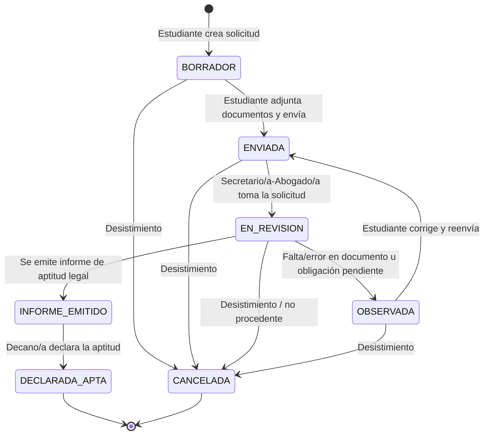

# 03. Alcance del MVP, flujo inicial y etapas SDD

**Proyecto:** SGT-SIAAF — Sistema de Gestión del Trámite de Titulación integrado al SIAAF
**Asignatura:** Desarrollo Basado en Plataformas (5.º ciclo, Computación, UNL) — ACD1
**Responsable de este archivo:** Integrante 3 — Royel Jima (alcance) · **Elaboración conjunta del borrador:** Integrante 5 — Juan Calopino
**Estado:** Propuesta inicial, **pendiente de acuerdo del equipo y de validación del docente**

> Todo lo marcado como *propuesta* o *por confirmar* no debe tratarse todavía como requisito. Las fuentes normativas provienen del *Reglamento de Régimen Académico de la UNL* (OCS, 27-01-2021), en adelante **RRA-UNL**.

---

## 1. Dónde empieza y dónde termina el proceso

El banco de proyectos advierte que el trámite completo es demasiado amplio y pide un **subproceso concreto**. Según el RRA-UNL, el camino de titulación de grado incluye, entre otras etapas: proyecto de investigación (Arts. 223–226), dirección del trabajo (Art. 228), ejecución (Art. 227), informe (Art. 229), certificado de culminación del director y aprobación de la unidad (Art. 231), registro de la calificación (Art. 232), **declaratoria de aptitud legal** (Art. 235) y designación de tribunal y sustentación (Arts. 236–237).

### Subproceso propuesto para el MVP

> **Solicitud de declaratoria de aptitud legal previa a la sustentación** (RRA-UNL, Art. 235).

| Elemento | Propuesta |
|---|---|
| **Inicio** | El estudiante, con su trabajo de integración curricular culminado y certificado por su director, crea la solicitud. |
| **Fin** | La solicitud queda en un estado final: **declarada apta** (después, fuera del sistema, el aspirante pide tribunal al Director/a de carrera, Art. 236) o **cancelada**. |
| **Fuera de los límites** | Todo lo anterior (proyecto, tutoría, informe, calificación de la unidad) y todo lo posterior (tribunal, sustentación, grado). |

### Por qué esta etapa

- El RRA-UNL define **quién la solicita, qué documentos se adjuntan, quién verifica y en qué plazo** (ocho días laborables).
- Contiene el caso de **observación/corrección**: si el Secretario/a-Abogado/a detecta una obligación pendiente, no emite el informe y notifica al interesado.
- Es la etapa donde se juntan documentos de varias dependencias (carrera, idioma, Tesorería, Secretaría), lo que encaja con la queja de que el trámite **demora y pasa por varios departamentos** (por confirmar, ver `01`).
- Es acotada para el ciclo (sección 7) y rica para ejercitar roles, estados, documentos y trazabilidad.
- Es donde más sentido tiene la futura relación con el SIAAF, sin depender de ella.

> **Por confirmar con el docente/requirente:** si esta etapa es la que la institución quiere digitalizar primero. Nota: el Art. 235 también aplica al examen complexivo y a la Unidad de Educación a Distancia; el MVP solo considera grado por trabajo de integración curricular en una Facultad.

---

## 2. Flujo inicial propuesto

Flujo ilustrativo basado en el Art. 235; los estados y decisiones oficiales deben validarse antes de convertirlos en requisitos.

### Pasos en lenguaje llano

1. **Registro.** El estudiante crea la solicitud, adjunta los documentos que le correspondan y la envía.
2. **Revisión inicial.** El Secretario/a-Abogado/a revisa la información y el expediente, y adjunta de oficio los requisitos que le corresponden (Art. 235).
3. **Observaciones, si existen.** Si hay una falta u obligación pendiente, registra una observación; la solicitud pasa a `OBSERVADA` y el estudiante la ve al consultar. En el reglamento, además, se informa al Decano/a y al Director/a de carrera (ver pregunta Q-14 en `05`).
4. **Corrección y nueva revisión.** El estudiante corrige o reemplaza el documento y reenvía.
5. **Resultado.** Se registra el informe de aptitud legal y la declaratoria del Decano/a, o la cancelación.

### Estados iniciales (sujetos a validación)

| Estado | Significado | Fuente / validación |
|---|---|---|
| `BORRADOR` | Solicitud creada, aún no enviada | Propuesta del equipo (no oficial) |
| `ENVIADA` | Entregada para revisión | Propuesta del equipo |
| `EN_REVISION` | Secretario/a-Abogado/a la está verificando | Derivado del Art. 235 · confirmar |
| `OBSERVADA` | Con observaciones pendientes de corrección | Derivado del Art. 235 (obligación pendiente) · confirmar |
| `INFORME_EMITIDO` | Informe de aptitud legal emitido | Derivado del Art. 235 · confirmar si es estado separado |
| `DECLARADA_APTA` | Decano/a declaró la aptitud | Art. 235 · confirmar |
| `CANCELADA` | Cerrada sin declaratoria | Propuesta del equipo |

### Transiciones y actores (propuesta)

| De → A | Actor autorizado |
|---|---|
| `BORRADOR → ENVIADA` | Estudiante (dueño de la solicitud) |
| `ENVIADA → EN_REVISION` | Secretario/a-Abogado/a |
| `EN_REVISION → OBSERVADA` | Secretario/a-Abogado/a (debe registrar al menos una observación) |
| `OBSERVADA → ENVIADA` | Estudiante |
| `EN_REVISION → INFORME_EMITIDO` | Secretario/a-Abogado/a |
| `INFORME_EMITIDO → DECLARADA_APTA` | Decano/a |
| `BORRADOR`, `ENVIADA`, `EN_REVISION` u `OBSERVADA → CANCELADA` | Estudiante (desistimiento) o Administrador; el Secretario/a-Abogado/a solo desde `EN_REVISION` (no procedente, con motivo) *(por confirmar)* |

Los estados `INFORME_EMITIDO`, `DECLARADA_APTA` y `CANCELADA` no admiten salida. Cualquier otra transición debe ser rechazada por el backend con un error controlado.

---

## 3. Actores del MVP

Se anclan provisionalmente al RRA-UNL (detalle en `02.md`):

| Rol en el MVP | Base normativa |
|---|---|
| **Estudiante / aspirante** | Art. 235 |
| **Secretario/a-Abogado/a de la Facultad** | Art. 235 (verifica requisitos, emite informe) |
| **Decano/a de Facultad** | Art. 235 (declara la aptitud) |
| **Administrador del sistema** | Propuesta técnica |

Quedan fuera del MVP: Director/a de carrera (Art. 236), director del trabajo (Art. 231), Tesorería y tribunal.

> **Por confirmar:** si el Decano/a delega la declaratoria, y si en Computación quien revisa es el Secretario/a-Abogado/a de la Facultad.

---

## 4. Documentos necesarios

El Art. 235 enumera los documentos que acompañan la solicitud:

| Documento | Fuente | Por confirmar |
|---|---|---|
| Récord académico legalizado por el Secretario/a-Abogado/a | Art. 235, n.º 1 | Si lo sube el estudiante o lo adjunta el Secretario/a de oficio |
| Certificado de la carrera de haber cumplido las horas de prácticas preprofesionales y de vinculación | Art. 235, n.º 2 | Quién lo emite y en qué formato |
| Certificado de aprobación del nivel de suficiencia de idioma B1 | Art. 235, n.º 3 | Formato y entidad emisora |
| Certificado del director del trabajo de culminación y aprobación | Art. 235, n.º 4 (Art. 231) | Formato |
| Certificado de Tesorería de no adeudar a la Institución | Art. 235, segundo n.º 4 | Si se obtiene en línea o presencial |

Observaciones:

- El artículo repite el número «4», por lo que se interpretan **cinco** documentos.
- El artículo indica que el interesado presenta los requisitos «que le correspondan» y que **los demás los adjunta de oficio el Secretario/a-Abogado/a**. Quién carga cada documento es una **pregunta abierta** (Q-03 en `05`).
- Para estudiantes en tercera matrícula que optan por examen complexivo, el certificado del director se reemplaza por un acta: queda fuera del MVP.
- Los formatos (PDF, tamaño máximo) no constan en las fuentes; el MVP propone **PDF, hasta 5 MB** *(supuesto técnico, no normativo)*.

---

## 5. Delimitación del MVP

| Incluido inicialmente | Fuera del MVP, salvo aprobación |
|---|---|
| Autenticación y roles (estudiante, secretario/a-abogado/a, decano/a, administrador) | Digitalización de todas las etapas de titulación |
| Registro y envío de solicitud de aptitud legal | Designación de tribunal y sustentación |
| Adjuntar y consultar los cinco documentos (PDF) | Firma electrónica institucional |
| Revisión y registro de observaciones | Automatización de decisiones académicas o legales |
| Corrección y reenvío por el estudiante | Integración real con el SIAAF sin acceso autorizado |
| Consulta del estado actual de la solicitud | Verificación automática de récord, B1 o deuda en Tesorería |
| Historial de cambios de estado (quién, cuándo, de qué estado a cuál) | Migración masiva de datos históricos |
| Consulta del tiempo transcurrido en cada estado, calculado del historial *(propuesta)* | Reportes y estadísticas institucionales |
| Documentación OpenAPI y pruebas automatizadas del backend | Notificaciones por correo/push |
| Entorno reproducible con Docker Compose | |

**Notificaciones.** El flujo exige «notificar al interesado»; en el MVP se resuelve como **estado + observación visible al consultar**. El correo se difiere.

**Plazo de 8 días laborables.** Se incluye solo como **fecha límite informativa** calculada al enviar; no bloquea operaciones. Pendiente: feriados y si el plazo se reinicia cuando el estudiante reenvía tras una observación (Q-05).

**SIAAF.** El MVP define una interfaz de servicio con datos simulados para lo que en el futuro podría venir del SIAAF (récord, matrícula). No se asume que exista una API.

---

## 6. Relación con las etapas SDD (GitHub Spec Kit)

| Etapa | ¿Qué debe definir el equipo? | Evidencia inicial |
|---|---|---|
| **constitution** | Principios: el sistema registra y apoya, **no sustituye decisiones humanas**; trazabilidad; mínimo privilegio; protección de datos; pruebas y OpenAPI obligatorias; uso declarado de IA; flujo de ramas y revisión por pares. | Archivo de constitución del repositorio |
| **specify** | Problema, actores, historias de usuario, requisitos funcionales/no funcionales y criterios de aceptación de la aptitud legal. | `specification.md` (Semana 2) |
| **clarify** | Preguntas sin resolver: quién carga cada documento, roles reales, estados oficiales, plazo y feriados, acceso a SIAAF, flujo actual. | `05-validacion-retroalimentacion.md` |
| **plan** | Arquitectura preliminar (API REST + persistencia + RBAC + JWT), tecnología preliminar (Django + DRF, ver `04`), contenedores y pruebas. | ADR / plan técnico (Semana 3) |
| **tasks** | Tareas verificables, cada una vinculada a un requisito y un criterio de aceptación. | Issues del repositorio |

La **constitución** fija los principios; la **especificación** define *qué*; las **aclaraciones** reducen ambigüedades y actualizan la especificación; el **plan** define *cómo*; las **tareas** se derivan de requisitos y plan. Esto se refleja en la **matriz de trazabilidad** (requisito → criterio de aceptación → endpoint → prueba) exigida desde la Semana 2.

---

## 7. Alcance frente al calendario de la asignatura

La **Unidad 1 (backend)** dura 5 semanas y el sistema completo (backend, web y móvil) se cierra en la Semana 16.

| Unidad / semanas | Entregable propuesto |
|---|---|
| **Unidad 1 — Backend (sem. 1–5)** | Modelos (solicitud, documento, observación, historial), API REST con estados y transiciones, RBAC, JWT, validaciones, errores estandarizados, OpenAPI, pruebas, Docker. |
| **Unidad 2 — Web (sem. 6–10)** | Login, crear/enviar solicitud, subir documentos, ver observaciones y estado; panel de revisión para Secretario/a-Abogado/a y Decano/a. |
| **Unidad 3 — Móvil (sem. 11–16)** | App acotada: consulta de estado y observaciones, y reenvío de documentos corregidos (si alcanza el tiempo). |

Prioridad si el tiempo aprieta (de mayor a menor): estados y transiciones con historial → observaciones → carga de documentos → control de acceso por rol → fecha límite informativa.

---

## 8. Decisiones pendientes del equipo

1. ¿Se acepta el subproceso de aptitud legal como MVP?
2. ¿`INFORME_EMITIDO` y `DECLARADA_APTA` quedan separados o se fusionan?
3. ¿Quién carga cada uno de los cinco documentos?
4. ¿La app móvil será solo de consulta?
5. ¿Se incluye la consulta de tiempo por estado en el MVP?

## 9. Fuentes

- Universidad Nacional de Loja. (2021). *Reglamento de Régimen Académico de la Universidad Nacional de Loja* (Arts. 212, 216, 221–237).
- Universidad Nacional de Loja. (2026). *Sílabo de Desarrollo Basado en Plataformas* (Carrera de Computación, 5.º ciclo).
- Universidad Nacional de Loja. (2026). *Banco de proyectos para ACD1* (Proyecto 6).
- Equipo SGT-SIAAF. (2026). `01-problema-contexto.md`, `02.md`, `04-decision-tecnica-riesgos.md`, `05-validacion-retroalimentacion.md`.
